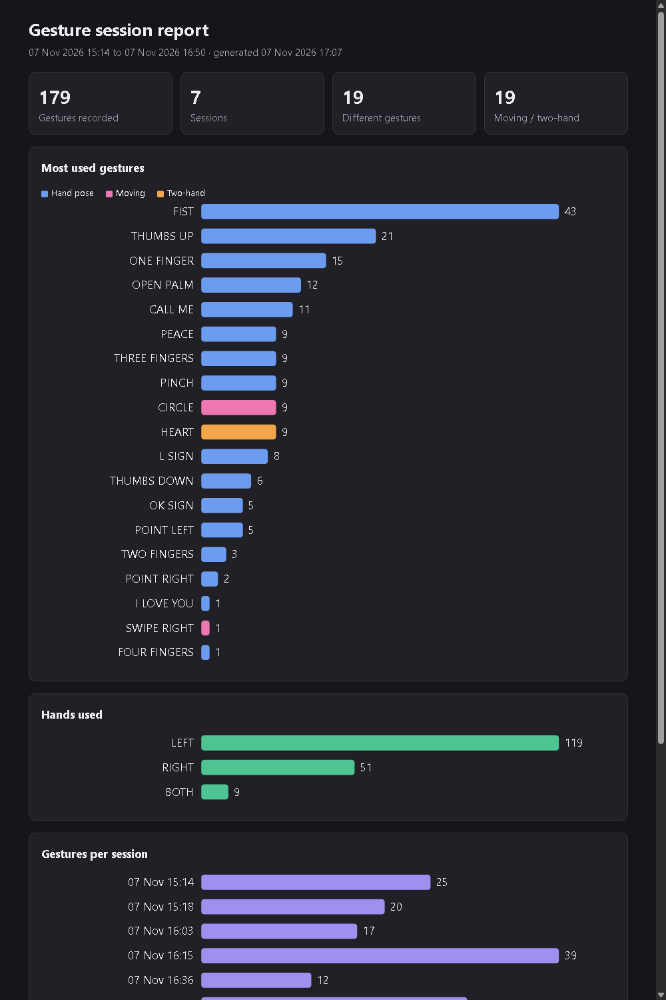

# Hand_Gesture_Analyser

[](https://github.com/NotADIM2/Hand_Gesture_Analyser/actions/workflows/tests.yml)

Team_Project. A real-time hand gesture analyser: it reads your webcam, finds your
hands with MediaPipe, recognises 17 hand poses plus 8 moving and two-hand
gestures (25 in total) with geometric rules, keeps a gesture history in SQLite, and
can control PowerPoint or your music with gestures (behind a gesture password). It
can also draw in the air, spell words with sign-language letters, and measure its
own accuracy on your team's recorded hands, comparing the rules with a trained
machine-learning model.

## Features at a glance

| | |
|---|---|
| **25 gestures** | 17 hand poses, 6 moving gestures (swipes, wave, circle), 2 two-hand gestures (clap, heart) |
| **Teach new poses** | Press `t`, name a pose, show it for 2 seconds: it's recognised from then on, and committing its file shares it with everyone |
| **Finger counting** | Fingers up on one or both hands, 0–10, always on screen |
| **Two classifiers** | Geometric rules (default) or a trained k-NN model (`--classifier ml`), compared on real hands |
| **Gesture control** | Run a PowerPoint slideshow or your music player, unlocked by a gesture password |
| **Air drawing** | Pinch to draw on the video, fist to clear, `s` to save the picture |
| **Sign letters, spoken** | Spell words with ASL fingerspelling letters; each finished word is spoken aloud, offline |
| **Hand exercise coach** | Guided routine (open/close, thumb touches, count to five) with repetition counting, timing, range of motion and progress in the report |
| **History and reports** | Every gesture saved to SQLite; HTML session report with charts; accuracy report per gesture and per person |
| **Honest feedback** | Shows how many of the last 10 frames agree, never a made-up confidence % |
| **Speed benchmark** | `--benchmark` times every pipeline stage and saves a table of averages |
| **Tested** | 240+ automated tests, no webcam needed, run on every push by GitHub Actions |

## Demo in 5 minutes

```powershell
.venv\Scripts\activate
python app.py
```

1. **Poses**: show a fist, thumbs up, peace, rock, call me; the label and stability
   appear on screen, with the number of fingers up (try both hands: 0–10). Press `f`
   to see the finger measurements behind each decision.
2. **Moving gestures**: swipe, wave, draw a circle; follow the magenta trail and the
   banner. Two hands: make a heart.
3. **Air drawing**: press `d`, pinch and draw, fist to clear, `s` to save.
4. **Sign letters**: press `a`, spell a word, e.g. **BUY** (four fingers, two fingers, call me).
5. **Control**: press `m`, show **FIST → PEACE → THUMBS UP** to unlock, click a
   PowerPoint window and swipe through slides.
6. **Exercises**: press `e` and follow the routine on screen (and spoken): open and
   close, thumb-to-fingertip touches, count to five.
7. **Teach**: show your pinky alone (UNKNOWN), press `t`, type `PINKY PROMISE`,
   Enter, hold the pose: from now on it's recognised.
8. **Results**: quit, then `python scripts/session_report.py` and open
   `reports/session_report.html`; `python scripts/evaluate.py` for accuracy, rules vs ML.



## Architecture

```
USER → WEBCAM → IMAGE PROCESSING (OpenCV) → HAND DETECTION (MediaPipe)
     → FEATURE EXTRACTION → GESTURE ANALYZER ─┐
                          → MOTION ANALYZER ──┴→ CONTROLLER (optional key presses)
                                               → RESULT / UI + GESTURE HISTORY (SQLite)
```

| Step | Module | Does |
|---|---|---|
| Configuration | `config.py` | All constants and thresholds |
| Webcam + image processing | `camera.py` | Capture, resize, mirror, BGR→RGB, camera errors |
| Hand detection | `hand_detector.py` | MediaPipe Hand Landmarker: up to 2 hands, 21 landmarks, Left/Right |
| Feature extraction | `feature_extractor.py` | Landmarks → extended fingers, joint angles, distances, directions |
| Gesture analyzer | `gesture_analyzer.py` | Features → gesture (rule-based), smoothed over recent frames |
| Motion analyzer | `motion_analyzer.py` | Palm paths over time → swipes, wave, circle; both hands → clap, heart |
| Controller | `controller.py` | Gestures → key presses, using a profile from `config.py`; off by default |
| Gesture history | `database.py` | SQLite, written from a background thread |
| Result / UI | `ui.py` | Skeleton, result panel, history and feature panels, keys |
| Teaching | `teach.py` | Poses taught live with `t`, checked before the normal classifier |
| Benchmark | `benchmark.py` | Times each pipeline stage (`--benchmark`) |
| Air drawing | `air_draw.py` | Pinch to draw on the video, fist to clear |
| Exercise coach | `exercise_coach.py` | Guided hand exercises: counts, times and measures repetitions |
| Speech | `speech.py` | Speaks text with the system's offline voice, in the background |
| Sign letters | `sign_language.py` | Poses → ASL fingerspelling letters, spelled into words |
| ML classifier | `ml_classifier.py` | k-nearest-neighbours alternative to the rules (`--classifier ml`) |
| Session report | `scripts/session_report.py` | History database → HTML page with charts |
| Accuracy report | `scripts/evaluate.py` | Per-gesture / per-person accuracy and confusion on recorded hands |
| Entry point | `app.py` | Connects the modules in pipeline order |

Feature extraction only sees landmark arrays (never frames), and the analyzer only
sees features (never landmarks), so a trained ML classifier can replace the rules
later by implementing `classify(features) -> str`.

## Setup (Windows, Python 3.12)

```powershell
git clone https://github.com/NotADIM2/Hand_Gesture_Analyser.git
cd Hand_Gesture_Analyser
py -3.12 -m venv .venv
.venv\Scripts\activate
pip install -r requirements-dev.txt
python scripts/download_model.py
```

On **Mac/Linux** use `python3.12 -m venv .venv` and `source .venv/bin/activate`.
If Windows says *running scripts is disabled* when activating, run
`Set-ExecutionPolicy -Scope CurrentUser RemoteSigned` once and try again.

## Run

```powershell
python app.py                 # default webcam
python app.py --camera 1      # another webcam
python app.py --no-history    # don't save to the database
python app.py --control presentation   # start with gesture control on (or: media)
python app.py --classifier ml           # recognise poses with the trained model instead of rules
python app.py --fullscreen              # start full screen (w toggles)
python app.py --benchmark               # time every pipeline stage
python app.py --person Alex             # your name in poses you teach (default: git user.name)
python app.py --mute                    # no speech (sign letters, exercise coach)
```

| Key | Action |
|---|---|
| `q` / `Esc` | Quit (closing the window also works) |
| `h` | Show/hide gesture history |
| `f` | Show/hide the feature panel (for tuning) |
| `c` | Clear all saved history |
| `m` | Gesture control: off → presentation → media → off |
| `d` | Air drawing on/off |
| `a` | Sign letters on/off |
| `e` | Hand exercise coach on/off (starts the routine) |
| `s` | Save a picture of the window to `data/snapshots/` |
| `t` | Teach a new pose (type a name, Enter; Esc cancels) |
| `w` | Full screen on/off (Esc also leaves full screen) |

History is saved in `data/gesture_history.db`, one row each time a new gesture
becomes stable (not once per frame).

## Gestures

| Gesture | Rule |
|---|---|
| OK SIGN | Thumb and index tips touching; middle, ring and pinky extended |
| PINCH | Thumb and index tips touching; index half bent; middle, ring and pinky folded |
| THUMBS UP | Only the thumb extended, pointing up and above the rest of the hand |
| THUMBS DOWN | Only the thumb extended, pointing down and below the rest of the hand |
| OPEN PALM | All five fingers extended |
| FOUR FINGERS | Index, middle, ring and pinky extended; thumb folded |
| FIST | No fingers extended |
| POINT LEFT | Only the index finger extended, pointing left on screen |
| POINT RIGHT | Only the index finger extended, pointing right on screen |
| ONE FINGER | Only the index finger extended, pointing up or down |
| L SIGN | Thumb and index extended |
| PEACE | Index and middle extended and spread apart (≥ 15°) |
| TWO FINGERS | Index and middle extended and held together |
| THREE FINGERS | Index, middle and ring extended |
| ROCK | Index and pinky extended |
| I LOVE YOU | Thumb, index and pinky extended |
| CALL ME | Thumb and pinky extended |

Rules are checked in this order. Anything else is shown as UNKNOWN.

### Moving and two-hand gestures

These follow the palm over the last second or two, so they work with any hand shape.
Each one appears in a banner at the bottom of the window, is saved to the history once,
and the pink line on screen shows the path the palm has taken.

| Gesture | How |
|---|---|
| SWIPE LEFT / RIGHT / UP / DOWN | Move your hand quickly and fairly straight across at least a quarter of the frame |
| WAVE | Move your hand left and right about twice, quickly |
| CIRCLE | Draw a full circle in the air with your hand |
| CLAP | Bring both hands together from well apart |
| HEART | Both hands: index tips touching at the top, thumb tips touching below, wrists apart; hold it briefly |

### Why no confidence percentage?

Rules don't produce a probability, so the UI doesn't invent one. Instead it shows
how many of the last 10 frames agreed on the gesture:

- **STABLE**: at least 7 of the last 10 frames agree.
- **UNCERTAIN**: recent frames disagree.
- **UNRECOGNISED**: a hand is visible but matches no gesture.

## Gesture control

Control mode turns gestures into key presses. It is **off** until you press `m` (or
start with `--control`), and the window shows `CONTROL: PRESENTATION` / `MEDIA` while
it is on, plus a flash such as `> NEXT SLIDE` every time it presses a key.

| Gesture | Presentation | Media |
|---|---|---|
| SWIPE LEFT | Next slide (→) | Next track |
| SWIPE RIGHT | Previous slide (←) | Previous track |
| THUMBS UP | Start slideshow (F5) | Volume up (repeats while held) |
| THUMBS DOWN | End slideshow (Esc) | Volume down (repeats while held) |
| FIST | Black screen (B) | Mute |
| OK SIGN | — | Play / pause |

Open Palm is deliberately not used: it's how your hand looks just before a swipe.

**Gesture password.** Control starts **locked**. Show **FIST → PEACE → THUMBS UP**,
each within 4 seconds of the last, to unlock it; the window shows the progress
(`LOCKED 1/3`, `2/3`, then `ON`). A wrong pose starts again. Switching control off
with `m` locks it again. Change or remove the password with `CONTROL_PASSWORD` in
`config.py` (`()` = no password).

**Controlling a presentation:**

1. Open your PowerPoint file.
2. Run `python app.py --control presentation` and show the password.
3. **Click on the PowerPoint window.** Key presses go to whichever window is in
   front; the gesture window keeps watching in the background.
4. Thumbs up to start the slideshow, swipe left/right to change slides, thumbs down
   to finish.

To switch control off or change profile, click the gesture window and press `m`.

Profiles are in `CONTROL_PROFILES` in `config.py`: each gesture maps to a label, a key
(a [pynput key name](https://pynput.readthedocs.io/en/latest/keyboard.html#pynput.keyboard.Key)
such as `right` or `media_play_pause`, or a single character), and optionally `True`
to repeat while held. Add your own profile there and it appears in the `m` cycle.

## Teach a new pose

Press `t`, type a name and press Enter. After a 3-second countdown, hold the pose
with one hand and move it a little while the app records 30 examples (about 2
seconds). From then on it's recognised like a built-in gesture: shown on screen,
smoothed, and saved to the history. While you type the name, keys are letters, not
commands.

Each pose is saved as its own file in `taught_poses/`, e.g.
`taught_poses/pinky_promise.json`, with its name, who taught it, when, and the hand
landmarks of every example. To remove a pose, delete its file. Teaching an existing
name again adds more examples to it, which makes it more reliable.

Good poses to try (the rules don't know them, so they show UNKNOWN before teaching):

| Name | Pose |
|---|---|
| PINKY PROMISE | Only the little finger up |
| GERMAN THREE | Thumb, index and middle finger up |
| MIDDLE THREE | Middle, ring and little finger up; index and thumb folded |

Taught examples are checked **before** the normal classifier, but only count when a
hand is very close to them (`TAUGHT_MAX_DISTANCE`), so they don't take over built-in
gestures. Avoid teaching poses that are close to a built-in one: a half-closed
"claw", for example, measures almost like a loose fist and would steal fists.

### Add a pose for everyone

Taught pose files are committed like code, so a pose taught on one laptop works on
every laptop that pulls it:

```powershell
git pull
git checkout -b pose/pinky-promise
python app.py --person <your name>      # press t, type the name, Enter, hold the pose
git add taught_poses/pinky_promise.json
git commit -m "Teach PINKY PROMISE"
git push -u origin pose/pinky-promise    # then open a pull request
```

When the pull request is merged into `main`, everyone gets the pose with
`git pull`. GitHub Actions runs `pytest` on the pull request, which checks the new
file: valid format, a name that isn't a built-in gesture, that it doesn't take over
any built-in gesture, and that it isn't too similar to another taught pose (more
than 10% of one pose's examples looking like the other). The app also prints a
warning at start if two taught poses are too alike. Each pose is a separate file,
so poses taught by different people never conflict.

## Finger counting

The result panel always shows how many fingers are up, across both hands:
`Fingers up: 7 (LEFT 5 + RIGHT 2)`. It uses the same extended-finger detection as the
gestures, so the `f` panel shows exactly which fingers were counted.

## Speed benchmark

`python app.py --benchmark` times every stage of each frame and shows the live total
on screen. When you quit, it prints and saves `reports/benchmark.md`:

| Stage | Average ms | Share |
|---|---|---|
| camera (includes waiting for the webcam's next frame) | … | … |
| hand detection | … | … |
| feature extraction, gesture classifier, motion analyzer, … | … | … |

It also reports the frame rate the processing alone could reach, without waiting
for the camera. Hand detection (MediaPipe) is normally the largest share; the rules,
features and drawing take well under a millisecond each.

## Air drawing

Press `d`. Touch your thumb and index fingertips together to put the pen down, move
to draw, open them to lift the pen. Make a fist to clear. Press `s` to save the
picture. Gesture control is paused while drawing.

## Sign letters

Press `a`. These poses match letters of the American Sign Language (ASL)
fingerspelling alphabet, and each one is added to the word on screen when it becomes
stable:

| Pose | Letter | | Pose | Letter |
|---|---|---|---|---|
| FOUR FINGERS | B | | TWO FINGERS | U |
| ONE FINGER | D | | PEACE | V |
| OK SIGN | F | | THREE FINGERS | W |
| L SIGN | L | | CALL ME | Y |
| FIST | S | | | |

Open palm adds a space and **speaks the finished word aloud**; thumbs up speaks
everything spelled so far. Swipe left deletes the last letter, wave clears everything.
Speech uses the voice built into the operating system (Windows System.Speech, `say`
on macOS, `espeak` on Linux), works offline, and runs in the background so the video
never pauses. `--mute` turns it off.
To repeat a letter, change pose (or lower your hand) and show it again. Gesture
control is paused while spelling.

**More letters can be taught.** Teach a pose (`t`) with a one-letter name, such as
`I` (pinky up) or `K` (index and middle up, thumb between them), and sign mode spells
it as that letter. What can't be taught: letters that need motion (J, Z), two-hand
signs, and letters that differ only in small thumb positions (A, S, M, N, T and E
are all closed fists, and R crosses two fingers): the measurements can't tell those
apart.

## Hand exercise coach

Press `e` to start a short guided routine. The screen shows the current exercise, the
instruction and the repetition count; new exercises are also announced aloud.

| Exercise | What to do | Counted when |
|---|---|---|
| OPEN AND CLOSE (×10) | Open the hand wide, then make a fist | Fist → open again |
| THUMB TOUCHES (×3) | Touch the thumb to the index, middle, ring and little fingertip in turn | A full round, in order |
| COUNT TO FIVE (×3) | Show 1, 2, 3, 4, then 5 fingers | Each number held briefly, in order, up to five |

For each exercise it records the repetitions and time, and for open-and-close how
far the fingers open and close (average bend angle at the middle finger joints, 180°
= straight). Results are saved in the history database, and the session report has
a **Hand exercises** section with seconds per repetition over time, so you can see
progress across days. Change the routine or the thresholds in `config.py`
(`EXERCISE_ROUTINE`, `EXERCISE_OPEN_ANGLE`, ...).

It's an exercise tracker for practice and desk breaks, **not a medical device**: it
doesn't diagnose or assess anything.

## Accuracy on real hands

The automated tests use synthetic hands. To measure how well the rules work on
**real** hands, each team member records samples, then runs the report:

```powershell
python scripts/record_samples.py --person <your name>   # hold a gesture, press its key
python scripts/evaluate.py --save reports/accuracy.md
```

The report gives overall accuracy, accuracy per gesture and per person, and a
confusion table (e.g. "PEACE recognised as TWO FINGERS: 3 times") that shows which
thresholds in `config.py` to tune. Commit `tests/fixtures/recorded_hands.json` and the
report: `pytest` then also checks that the rules get at least 80% of the recorded
samples right.

## Session report

```powershell
python scripts/session_report.py                    # all sessions
python scripts/session_report.py --session latest   # just the last run
```

Writes `reports/session_report.html`: totals, the most used gestures (hand poses vs
moving and two-hand gestures), which hands were used, gestures per session, a
table of sessions, and hand exercise results over time. It is a single file with no internet needed; open it in any
browser. It is built from your local history, so it isn't committed.

## Rules vs machine learning

`ml_classifier.py` is a k-nearest-neighbours (k-NN) model. It sees the same hand
measurements as the rules (extended fingers, joint angles, distances, directions) and
labels a hand with the gesture most common among the 5 most similar hands it was
trained on; a hand unlike anything it has seen is UNKNOWN.

```powershell
python scripts/train_classifier.py      # train and save models/gesture_knn.npz
python app.py --classifier ml           # use it live
python scripts/evaluate.py              # accuracy: rules vs ML side by side
```

It is trained on synthetic hands (randomly tilted, rotated, jittered and with looser
or tighter fingers) plus every real recorded sample, so recording more hands and
training again improves it. The comparison in the accuracy report is
**leave-one-out**: for each real sample the model is trained on everything else, so
it is never graded on a hand it has already seen.

| | Rules | k-NN |
|---|---|---|
| Needs training data | No | Yes (synthetic + recorded) |
| Explains its answer | Yes: "all five fingers extended" | By its nearest examples |
| New gesture | Write a rule | Record examples |
| Gets better with more recordings | Only by tuning thresholds | Automatically, after training again |

## Design decisions

- **Rules first, not machine learning.** Geometric rules need no training data,
  run on any laptop, and every decision can be explained ("all five fingers
  extended"). The analyzer only needs `classify(features) -> str`, so a trained model
  can replace the rules later and be compared using the accuracy report.
- **No fake confidence percentage.** Rules don't produce a probability, so the UI
  shows how many of the last 10 frames agreed instead of inventing a number.
- **Measurements in palm sizes.** Distances are divided by the palm size and angles
  use MediaPipe's 3D world landmarks, so gestures work near or far from the camera
  and for small or big hands.
- **Smoothing and logging once.** A gesture must win 7 of the last 10 frames to count,
  and is saved once when it becomes stable, not 30 times a second. A hand that drops
  out for under half a second keeps its history, so it isn't logged twice.
- **Pinch needs a half-bent index.** In a fist the thumb can also touch the index
  finger; the index angle (`PINCH_MIN_INDEX_ANGLE`) tells the two apart.
- **Point Left/Right use the index finger's direction**, not the hand's, because a
  pointing hand is often tilted.
- **Open palm triggers no action** in control mode: it's how a hand looks right before
  a swipe, so it would fire by accident.
- **Moving gestures are events with a cooldown.** A swipe is reported once, then that
  hand is ignored briefly, so one movement can't skip two slides. A jump too large for
  one frame is treated as a tracking glitch (MediaPipe swapping Left/Right), not a
  swipe.
- **Safe by default.** Control mode is off until asked for and then locked by a
  gesture password; tests use a fake keyboard and never press real keys.
- **Generous heart check.** MediaPipe's fingertips are rough when two hands touch,
  so the heart allows a wider gap; the `f` panel shows the live values for tuning.

## Testing

```powershell
python -m pytest
```

The tests don't need a webcam, and the controller tests use a fake keyboard, so
running them never presses real keys. They use synthetic hands plus real landmarks taken
from MediaPipe's public sample photos (`tests/fixtures/sample_hands.json`).

Each module can also be checked on its own with the live camera:

```powershell
python camera.py              # live feed + FPS
python hand_detector.py       # skeleton + Left/Right
python feature_extractor.py   # extended fingers + thumb direction
```

### Testing with your own hands

```powershell
python scripts/record_samples.py --person <your name>
```

Hold a gesture and press its key (shown on screen) to save it. Samples go to
`tests/fixtures/recorded_hands.json`; see [Accuracy on real hands](#accuracy-on-real-hands).
Commit them so every teammate's hands are covered.

## Tuning

All thresholds are in `config.py`. Press `f` in the app to see the measured values
live, then adjust:

- `FINGER_STRAIGHT_ANGLE`: lower it if relaxed open fingers count as folded.
- `THUMB_EXTENDED_LATERAL`: raise it if a tucked thumb counts as extended.
- `OK_TOUCH_RATIO`: raise it if the OK sign or Pinch isn't detected.
- `PINCH_MIN_INDEX_ANGLE`: lower it if a Pinch shows as Fist; raise it if a Fist shows as Pinch.
- `PEACE_MIN_SPREAD`: the angle that separates Peace from Two Fingers.
- `STABILITY_WINDOW` / `STABILITY_MIN_AGREEMENT`: smoothing.
- `SWIPE_MIN_DISTANCE` / `SWIPE_MAX_SECONDS`: lower the distance or allow more time if
  swipes are missed; the opposite if ordinary movement triggers them.
- `WAVE_MIN_SWINGS` / `WAVE_MIN_AMPLITUDE`, `CIRCLE_MIN_TURN`: how much waving or circling counts.
- `CLAP_START_DISTANCE`, `HEART_TOUCH_DISTANCE`: two-hand gestures, in palm sizes.

## Troubleshooting

- **Window too small**: press `w` for full screen, or drag the window's edge. The
  picture is processed at 640x480 for speed and scaled up for display, keeping its
  shape (black bars fill the sides on a wide screen).
- **"Could not open camera"**: close other apps that use the webcam (Zoom, Teams,
  browser tabs), or try `--camera 1`.
- **Left/Right swapped**: `MIRROR_FRAME` in `config.py` must stay `True`, because
  MediaPipe's labels assume a mirrored (selfie) image.
- **`INFO`/`W0000` lines at start-up**: MediaPipe's own log messages. They are
  harmless and can be ignored.
- **Old tutorials use `mp.solutions.hands`**: that module was removed in current
  MediaPipe. This project uses the Tasks API (`mediapipe.tasks.python.vision`).
- **Control mode presses nothing**: show the password first (the status says
  `LOCKED 0/3` until you do), then click the window you want to control: keys go to
  the window in front.
- **`Trained model not found`** with `--classifier ml`: run
  `python scripts/train_classifier.py`.
- **A gesture is missed or confused**: press `f` to see the live values, compare them
  with the thresholds in `config.py` (see [Tuning](#tuning)), and record samples to
  measure the change with `python scripts/evaluate.py`.
